<!--
  Psst. Du liest den Quelltext. Respekt.
  Der Prinz ist im Palast. Such die Sanduhr ganz unten.
  Psst. You're reading the source. Respect.
  The prince is in the palace. Look for the hourglass at the very bottom.
-->

<p align="center">
  
</p>

<p align="center">
  <a href="https://lunaver.app"></a>
  <a href="https://apps.apple.com/app/id6793892216"></a>
  
</p>

<p align="center">
  <strong>Lunaver Studio → <a href="https://lunaver.app">lunaver.app</a></strong>
</p>

---

### `> whoami`

**EN** · We build local-first AI that runs on your own Apple device. Accessibility comes first, not last: if a blind person can't use it with VoiceOver and their voice, it isn't done.

**DE** · Wir bauen lokale KI, die auf deinem eigenen Apple-Gerät läuft. Barrierefreiheit kommt zuerst, nicht zum Schluss: Wenn ein blinder Mensch es nicht mit VoiceOver und Stimme bedienen kann, ist es nicht fertig.

---

### `> ls ./projects`

| | Project | EN | DE |
|---|---|---|---|
| ◐ | **[Lunaver Studio](https://lunaver.app)** | Native AI writing and publishing studio for macOS. From the first idea to the finished manuscript, locally with Apple Foundation Models and MLX. | Natives KI-Schreib- und Publishing-Studio für macOS. Von der Idee bis zum Manuskript, lokal mit Apple Foundation Models und MLX. |
| △ | **[TRINITY](https://github.com/Ponydog1970/TRINITY)** | iOS vision aid: live AI video analysis, LiDAR scans, RAG and a multi-agent system. | iOS-Sehhilfe: Live-KI-Videoanalyse, LiDAR-Scans, RAG und Multi-Agenten-System. |
| ◌ | **Lumi** | Voice-first assistant layer: operate the app by talking, not tapping. | Sprachassistenz: die App per Stimme bedienen statt per Tippen. |

---

### `> cat stack.txt`

<p>
  
  
  
  
  
  
  
  
</p>

---

### `> cat principles.md`

```diff
+ local first          · your data stays on your device      · deine Daten bleiben auf deinem Gerät
+ accessibility first  · VoiceOver is a feature, not a fix   · VoiceOver ist Kern, kein Nachtrag
+ honest AI            · say which model really answered     · sagen, welches Modell wirklich geantwortet hat
+ quality over dates   · measured, reviewed, then shipped    · gemessen, geprüft, dann veröffentlicht
- dark patterns        · never                               · niemals
```

---

<details>
<summary><code>&gt; ./palace --enter</code></summary>

<br>

```text
 ⧗  ACHIEVEMENT UNLOCKED · Palast betreten / Palace entered

    Gerüchte aus München / Rumors from Munich:

    · Er springt über Abgründe.            → man nennt sie Deadlines.
      He leaps across chasms.              → they're called deadlines.

    · Er läuft an Wänden entlang.          → man nennt sie App Review.
      He runs along walls.                 → they're called App Review.

    · Er spult die Zeit zurück.            → man nennt es git revert.
      He rewinds time.                     → it's called git revert.

    · Er kämpft gegen sein eigenes Schattenbild.
                                           → man nennt es Code Review.
      He fights his own shadow.            → it's called code review.

    · Jedes Level: 60 Minuten. Die Sanduhr läuft.
      Every level: 60 minutes. The hourglass is running.

    Ob er wirklich ein Prinz ist? Nur im übertragenen Sinne.
    Is he really a prince? Only figuratively.
```

</details>

<p align="center">
  <sub><a href="https://trinity-labs-munich.com"><code>TRINITY AI LABS · Munich</code></a> <code>· local-first since day one</code></sub><br>
  <sub title="The sands of time are on our side.">⧗</sub>
</p>
